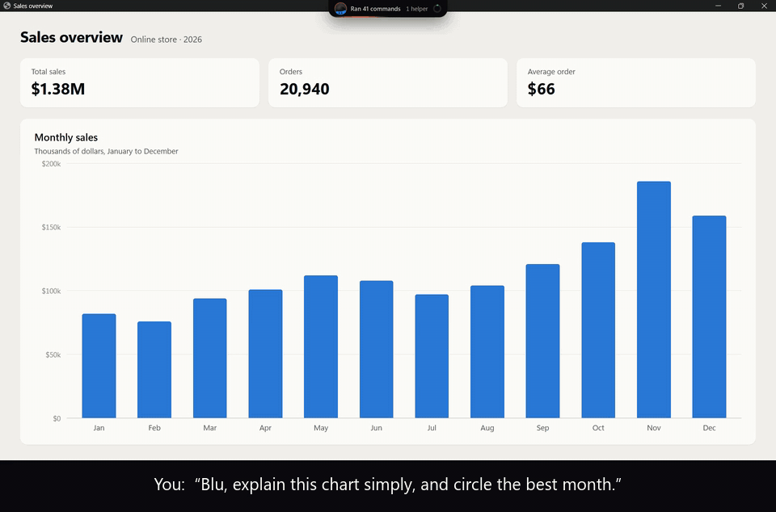
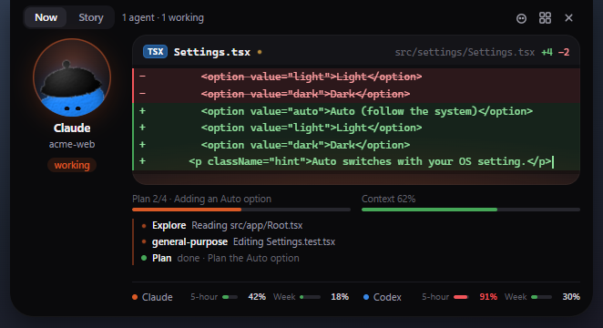
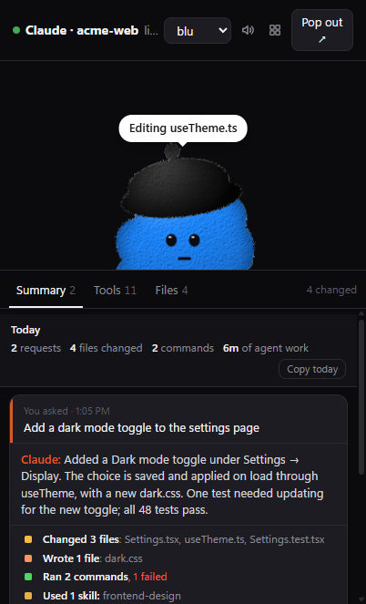
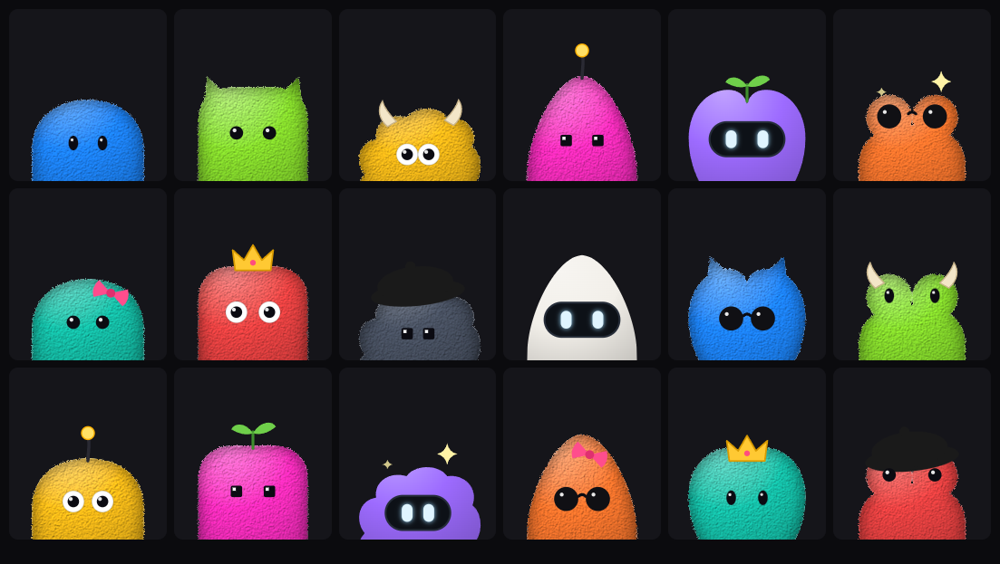

<div align="center">


# dotpals

**See what your coding agent actually did.**

A small floating pal that watches Claude Code, Codex or any agent and checks its work: which files changed, which commands ran, and whether the tests really passed, read from their output, not the agent's word. When Claude breaks the tests, dotpals sends it back to fix them. Any AI tool can ask dotpals what really happened. And now you can talk to it: **Blu** sees your screen, draws on it as it explains, and uses your apps.

```bash
npx dotpals@latest setup
```

<sub>One command on Windows, macOS or Linux. Free, open source, and your agents’ work stays on your computer. Or straight from GitHub: `npx --allow-git=all github:rikinshah787/dotpals setup`</sub>

[](https://github.com/rikinshah787/dotpals/actions/workflows/ci.yml)
[](LICENSE)


**[Install](#install)** · **[Talk to Blu](#talk-to-blu)** · **[Features](#features)** · **[Plug in any agent](#plug-in-any-agent)** · **[Docs](https://rikinshah787.github.io/dotpals/guide/)**

**[⭐ Star dotpals](https://github.com/Rikinshah787/dotpals/stargazers)** if your agent ever said "Done!" and you weren't sure · **[Tell us what's confusing](https://github.com/Rikinshah787/dotpals/issues/new)**

</div>

## New in 0.12: Talk to Blu

<p align="center"></p>

Press **Ctrl+Shift+Space** and talk. Blu is the pal in your notch:

- **It explains your screen.** "What's this error?" Blu answers out loud and circles what it means. Ask for it step by step and it writes the working on your screen, line by line, as it talks.
- **It does things.** "Play some jazz", "turn it down a bit", "make this window smaller". Each one shows ✓ or ✗.
- **It uses your apps.** Notion, Linear, Sentry, Google Calendar or any MCP server. A change waits for your yes; nothing is ever sent, deleted or paid for.
- **It hands coding work to Claude and checks it.** "Have Claude fix the failing test": Blu writes down what done means, Claude Code does it, and dotpals checks what really happened.
- **It runs on the AI you already have.** Claude Code or Codex on your subscription, an API key, or Ollama. Hearing and Blu's voice run on your computer.

More in [Talk to Blu](#talk-to-blu). 0.11 brought the report card, replay and rewind, the morning brief and "It's stuck"; all of it is in the [changelog](CHANGELOG.md).

## Why

Coding agents do a lot in a single request: they read dozens of files, edit a handful, run tests, retry and search. The chat scrolls by and the diff is spread across files. dotpals keeps a live, plain-language record next to your editor, so you can always answer:

- **What did it change?** Every file edited, created or deleted, with the diff one click away.
- **What did it run, and did it work?** Every command with its output, and **fixed on try 2** or **still failing after 3 tries**.
- **Did it fix what it broke?** Claude Code is sent back when its tests fail, and a test changed just to make it pass is caught.
- **Is the code as it is now tested?** "Changed 2 files after the tests passed: not tested since" is impossible to miss.
- **What did I get done today?** A running tally, copied as Markdown for a standup or PR in one click.

<div align="center">


<sub>🔊 <a href="https://github.com/Rikinshah787/dotpals/releases/download/v0.9.0/dotpals-launch-1080p.mp4">Watch the launch video with sound (47 s, 1080p)</a> · <a href="https://github.com/Rikinshah787/dotpals/releases/download/v0.9.0/dotpals-launch-square.mp4">square cut</a></sub>
</div>

## Features

- **Make agents fix failing tests** (Claude Code, on by default): finishing, committing or pushing while its tests fail, or before it tested its last change, sends Claude back to fix them, at most twice per request. A test faked to pass (an assertion taken out, a skip added, an expectation changed) is caught too.
- **Was it tested?** Results are read from the test output itself (jest, vitest, pytest, go, cargo, dotnet, Maven, Gradle, RSpec and more), never just the exit code. "0 tests ran" is never a pass.
- **Report card**: your agents side by side: changes tested and passed, changes never tested, tests changed to pass, claims that didn't happen, and what the tokens bought.
- **Replay and rewind**: step through any request, and (with restore points on) put its files back as they were.
- **Morning brief and "It's stuck"**: what your agents did since yesterday, and a ping when one keeps failing at the same thing.
- **The story, not the log**: each request reads as a few chapters (*Changed 5 files · Tests failed twice, then passed · Committed and pushed*), with anything risky flagged: `.env` changed, a force-push, two agents editing the same file.
- **Ask dotpals from any agent**: an [MCP server](#ask-dotpals-from-any-agent-mcp), so Claude Code, Codex, Cursor and others can check their work against what really happened.
- **The notch**: every agent in one island at the top of your screen, with a live diff, its plan, its context window and your usage limits. It opens when an agent needs your OK, and **Ctrl+Alt+Y** / **Ctrl+Alt+N** answer it.
- **Hand-off**: **Continue in ▾** hands a session to Codex, Claude Code or Gemini CLI with a note on what was done and what's left.
- **Dashboard**: every session with its requests, files and full log, search, stats, and export to Markdown or JSON.
- **A pal with personality**: nine characters that think, work, wait, celebrate and sulk, or [make your own](#make-your-own-pal).

<p align="center">
  
  &nbsp;
  
</p>

Every feature, in detail: **[the guide](https://rikinshah787.github.io/dotpals/guide/features.html)**.

## Talk to Blu

| Keys | What happens |
| --- | --- |
| **Ctrl+Shift+Space** (⌘⇧Space on macOS) | **Talk.** The notch opens and Blu listens. On Windows, hold the keys while you talk; or tap them and Blu listens until you pause |
| **Ctrl+Alt+C** (⌃⌥C) | **Circle and ask.** Draw around anything on screen, then ask about it |
| **Ctrl+Alt+D** (⌃⌥D) | **Dictate.** Say it, and it's typed where your cursor is |

Things to say:

- "What's this error?" · "Explain this step by step" · "Circle the button I need"
- "Play some jazz" · "Turn it down a bit" · "Put Spotify on the left half"
- "What's on my calendar today?" · "Create a page called Weekly plan in Notion"
- "Have Claude fix the failing test" · "What are my agents doing?" · "Stop"

**Set it up** in Dashboard → Settings:

- **Blu → Blu's brain**: Claude Code or Codex on your subscription, an API key (Anthropic, OpenAI, Gemini, OpenRouter), or Ollama on your computer.
- **Apps**: Notion, Linear and Sentry in one click, Google Calendar with your own sign-in client, or any MCP server by its address or command.
- **Blu → Shortcuts**: your own keys.

The first time you talk, dotpals downloads a speech model (about 80 MB) and Blu's voice (about 330 MB), once. Both run on your computer.

**What Blu won't do without you:**

- Change anything in your apps before you say yes. Even then it never sends, deletes or pays for anything.
- Click, type or press keys, unless you turn that on.
- Send coding work to an agent before you say "send it".

What it does on your computer is a fixed list, checked again before it runs. It never follows instructions written on your screen.

**Your privacy.** Your voice stays on your computer. A screenshot goes to Blu's brain only when you ask about the screen, or circle something. With Ollama, nothing leaves your computer at all.

Blu is tested on Windows. macOS (through dotpals.app, so permissions are asked in dotpals' name) and Linux (X11, with `playerctl`, `pactl` and `xdotool`) are new in this release. **[Everything about Blu →](https://rikinshah787.github.io/dotpals/guide/features.html#blu)**

## Make your own pal

<p align="center"></p>

Dashboard → **Settings → Make your own pal**: pick a body, eyes, something on top, any color and a name. Thousands of combinations, or **Surprise me**.

## Install

```bash
npx dotpals@latest setup
```

Needs Node 20 or newer. It installs the desktop pal in `~/.dotpals` (with its runtime, Electron, about 100 MB, once), adds the Claude Code plugin if you have Claude Code, picks up Codex, starts the pal at login and opens the dashboard. Run it again any time to update. Options: `--no-claude`, `--no-login`, `--no-start`.

- **Only the Claude Code plugin:** `/plugin marketplace add rikinshah787/dotpals`, then `/plugin install dotpals@dotpals`, restart Claude Code and run `/dotpals:pals`.
- **Codex:** nothing to install. dotpals follows Codex's session logs while the pal is running.
- **Cursor, Gemini CLI, OpenCode and GitHub Copilot CLI:** press **Connect** on the dashboard's **Agents** page. It backs up the agent's config first, and **Disconnect** takes out only what it added.
- **Any other agent:** see [Plug in any agent](#plug-in-any-agent).

## Using it

| | |
| --- | --- |
| **Ctrl+Alt+P** (⌘⌥P on macOS) | Show or hide the pal |
| **Ctrl+Shift+Space** · **Ctrl+Alt+C** · **Ctrl+Alt+D** | Talk to Blu · circle and ask · dictate |
| **▦** | The dashboard: sessions, logs, stats and settings |
| **–** | Minimize to the tray (the notch keeps watching) |

```bash
dotpals start       # open the floating pal
dotpals dashboard   # open the dashboard
dotpals status      # what's running and connected
dotpals doctor      # no pal or notch? checks and fixes it
dotpals mcp         # the MCP server (below)
```

## Ask dotpals from any agent (MCP)

`dotpals mcp` is an [MCP](https://modelcontextprotocol.io) server: Claude Code, Codex, Cursor and other assistants ask dotpals what your agents really did, and get the evidence instead of the agent's word. It only reads, from the pal running on this computer.

```bash
claude mcp add dotpals -- npx dotpals mcp
```

Codex and Cursor: command `npx`, arguments `dotpals mcp` (for Codex, under `[mcp_servers.dotpals]` in `~/.codex/config.toml`).

| Tool | Answers |
| --- | --- |
| `check_my_work` | For the agent itself, before it says "done": "Looks done", or what to fix first |
| `ready_to_merge` | The checks a reviewer would make: tests ran after the last change and passed (not because the tests were changed), nothing risky, committed |
| `test_status` | Is it really tested, and why the last run failed ("expected 3, got -1") |
| `agents_now` · `today` · `recap` | What each agent is doing, did today, or did request by request |
| `report_card` · `brief` | The agents side by side, and the morning brief or weekly recap |
| `risky_steps` · `handoff_note` | Force pushes, `.env` changes and more; a note for another agent to pick up a session |

## Privacy

Your agents' work stays on your computer. The bridge listens only on `127.0.0.1`, reads Claude Code's and Codex's logs locally, and sends nothing anywhere. The exceptions are your choice:

- **Blu**: what you say goes to the AI you picked for Blu's brain (nowhere, with Ollama), with a screenshot only when you ask about the screen.
- **Cloud (Jev)** test double-check, off by default: an unclear test run's output, with passwords, keys and emails removed.

History is a plain JSON file in `~/.dotpals` (`DOTPALS_HISTORY=0` turns it off). See [SECURITY.md](SECURITY.md) and the [privacy guide](https://rikinshah787.github.io/dotpals/guide/privacy.html).

## How accurate is it?

We check. `test/accuracy/cases` holds 36 real requests, and every claim dotpals made about them was checked by hand against what really happened:

| Claim | Claims | Right | Wrong | Unsure |
|---|---:|---:|---:|---:|
| Test results (passed, failed) | 99 | 91 | 1 | 7 |
| Risky steps | 14 | 14 | 0 | 0 |
| Retries ("fixed on try 2") | 15 | 14 | 1 | 0 |
| Ready to merge? | 36 | 35 | 1 | 0 |
| Why it stopped | 36 | 35 | 1 | 0 |
| What changed (git) | 10 | 9 | 1 | 0 |
| Tests changed to pass | 20 | 20 | 0 | 0 |
| Why tests failed | 25 | 25 | 0 | 0 |
| **All** | **255** | **243 (95.3%)** | **5** | **7** |

"Unsure" is a missing answer, not a false one. `npm run accuracy` lists the 5 wrong ones, and the test suite fails if a right claim turns wrong.

## How it works

```
Claude Code ── hooks + transcripts ┐
Codex ──────── session logs ───────┼──▶  bridge (127.0.0.1:5175)  ──▶  pal · notch · dashboard · MCP
your agent ─── POST /event ────────┘         one activity model
```

Your agents report what they do. A small local server, the bridge, turns it into one activity feed and keeps history in `~/.dotpals`. The pal, the notch and the dashboard show it live. Contributors: [docs/ARCHITECTURE.md](docs/ARCHITECTURE.md).

## Plug in any agent

| Agent | How it connects |
| ------- | --------------- |
| **Claude Code** | Hooks for live state and permission prompts, plus the session transcript |
| **Codex** (CLI, IDE extension, app) | Its session logs in `~/.codex/sessions`; nothing to set up |
| **Cursor**, **Gemini CLI**, **OpenCode**, **GitHub Copilot CLI** | **Connect** on the dashboard's Agents page |
| **Anything else** | POST JSON to `http://127.0.0.1:5175/event` |

```bash
curl -s localhost:5175/event -d '{
  "session": "run-42", "harness": "my-agent", "state": "working", "text": "Running tests",
  "activity": { "id": "call-1", "kind": "run", "title": "Run the tests", "status": "running",
                "body": { "command": "npm test" } }
}'
```

Send the same `id` again with `"status": "ok"` when it finishes. The Agents page has copy-paste snippets for curl, PowerShell, Node, Python and the shell. The full event format: **[the guide](https://rikinshah787.github.io/dotpals/guide/agents.html#any-agent)**.

## Use the pal in your own app

The pal is a dependency-free Web Component, `<dot-pal>`, for chat UIs, IDE panels and dashboards. It works in plain HTML, React, Vue, Svelte, Angular, Electron and VS Code webviews.

```html
<script type="module" src="https://unpkg.com/dotpals"></script>

<dot-pal id="agent" character="grok"></dot-pal>

<script type="module">
  const pal = document.getElementById('agent');
  pal.setState('thinking');
  pal.setState('working', { text: 'Running tests…' });
  pal.setState('done', { text: 'All green!' });
</script>
```

Or `npm install dotpals`, then `import 'dotpals'`. States, characters, attributes, events, styling and your own characters: **[the component guide](https://rikinshah787.github.io/dotpals/guide/component.html)**.

## Documentation

The full guide is at **[rikinshah787.github.io/dotpals/guide](https://rikinshah787.github.io/dotpals/guide/)**: every feature, Blu, each agent, the CLI, configuration, the bridge's HTTP API, the `<dot-pal>` component, privacy and troubleshooting. Its source is in [`site/guide/`](site/guide).

## Roadmap

- **More agents**: Windsurf, Cline, Aider and others, as each gets a documented way in.
- Signed installers for Windows and macOS, so Node isn't needed.

Ideas and pull requests are welcome. Open an [issue](https://github.com/rikinshah787/dotpals/issues) to discuss.

## Contributing

```bash
npm install        # dev only: Electron for the desktop window
npm test           # node --test, no dependencies needed
npm run float      # the desktop pal
npm run dashboard  # the dashboard
```

See [CONTRIBUTING.md](CONTRIBUTING.md). To support a new agent, add an adapter next to [`bridge/adapters/codex.js`](bridge/adapters/codex.js).

## Credits

- Reading test results and double-checking unclear ones builds on [claude-referee](https://github.com/ismaildasci/claude-referee) by Ismail Dasci (MIT): its test-output parsers, redaction rules and "done" question are adapted in `bridge/ui/testout.js`, `bridge/redact.js` and `bridge/checker.js`. See [THIRD_PARTY_NOTICES](THIRD_PARTY_NOTICES).
- The optional checkers are [Laya](https://huggingface.co/convaiinnovations/laya) by Convai Innovations (runs on your computer; dotpals installs it from PyPI when you click Set up Laya) and [TypeSafe](https://typesafe.ai)'s Jev, through its MIT-licensed SDK `@typesafe-ai/sdk`.

## Trademarks

Character names are playful nicknames. dotpals is not affiliated with or endorsed by Anthropic, OpenAI or any other AI company, and the characters are original artwork, not logos.

## License

[MIT](./LICENSE)
